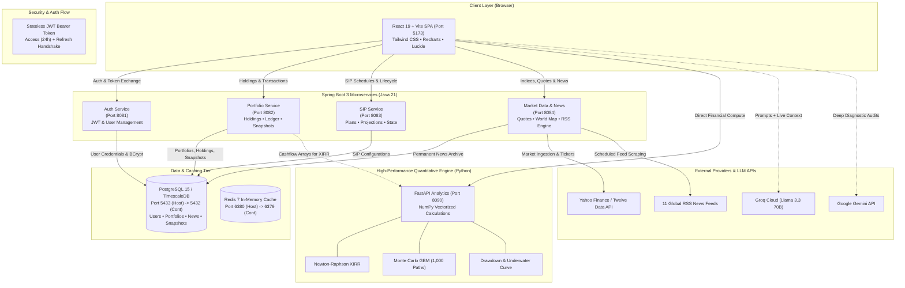

# 📈 LastStats — AI-Powered Investment & Algorithmic Wealth Platform

<div align="center">


[](https://adoptium.net)
[](https://spring.io/projects/spring-boot)
[](https://www.python.org/)
[](https://fastapi.tiangolo.com/)
[](https://react.dev/)
[](https://vitejs.dev/)
[](https://www.postgresql.org/)
[](https://www.timescale.com/)
[](https://redis.io/)
[](https://www.docker.com/)
[](https://groq.com/)
[](https://ai.google.dev/)

<p align="center">
  <strong>An enterprise-grade, distributed microservices platform for intelligent mutual fund tracking, algorithmic SIP simulations, real-time global market discovery, quantitative risk analytics, and AI-powered financial advisory.</strong>
</p>

[Explore Capabilities](#-core-capabilities) • [Architecture](#%EF%B8%8F-system-architecture) • [Quick Start](#-quick-start) • [Mathematical Models](#-quantitative--mathematical-models) • [API Guide](#-api-endpoints-reference)

---

</div>

## 📌 Executive Overview

**LastStats** bridges the gap between passive portfolio tracking and quantitative hedge-fund grade analysis. Designed for both retail investors seeking systematic SIP optimization and advanced traders demanding algorithmic forecasting, LastStats combines a resilient **Java Spring Boot microservices core**, a **high-throughput Python mathematical computing engine**, and a responsive **React 19/Vite UI** backed by real-time market data feeds and modern Large Language Models (LLMs).

### 🎯 Key Problems Solved
- **Irregular Cashflow Miscalculations**: Traditional CAGR fails when cash flows occur intermittently across SIPs. LastStats solves for exact annualized returns using iterative **Newton-Raphson XIRR** across every holding.
- **Uncertain Future Wealth Horizons**: Replaces static compound interest estimators with stochastic **Monte Carlo simulations (Geometric Brownian Motion)** across 1,000 randomized market trajectories, outputting P10, P50, and P90 confidence percentiles.
- **Drawdown & Capital Preservation**: Automatically tracks portfolio snapshot histories to compute historical peak-to-trough drawdowns, recovery intervals, and underwater equity curves.
- **Fragmented Market Data & News**: Unifies live Indian equity indices (Nifty 50, Sensex) and global exchanges (NASDAQ, S&P 500, FTSE) with an automated RSS news ingestion engine that aggregates, dedupes, and permanently archives global financial news.
- **Context-Aware AI Guidance**: Integrates high-speed conversational LLMs (Groq Llama 3.3 70B) dynamically injected with live market quotes alongside in-depth structured portfolio diagnostics (Google Gemini).

---

## 🌟 Core Capabilities

| Module | Features & Capabilities |
|---|---|
| 💼 **Portfolio Management** | • Multi-portfolio support per user<br>• Real-time transactional ledger (BUY, SELL, SIP, DIVIDEND)<br>• Automated holding unit calculations & weighted average NAV tracking<br>• Per-holding real-time XIRR computation<br>• Automated daily midnight snapshot scheduler (`portfolio_snapshots`) for historical charting |
| 🔄 **Systematic Investment Plan (SIP)** | • Automated SIP lifecycle management (Active, Paused, Resumed)<br>• Flexible investment frequencies & custom deduction day schedules<br>• 5-year compounding projection engine parameterized by return expectations |
| 📊 **Quantitative & Algo Engine** | • **Monte Carlo Growth Forecasting**: 1,000 paths modeled using Geometric Brownian Motion (GBM)<br>• **P10 / P50 / P90 Probability Bands**: Visualized via interactive Recharts area/line graphs<br>• **Historical Drawdown Analysis**: Max drawdown percentage, peak dates, recovery durations, and underwater equity curve |
| 🌍 **Market Intelligence & World Map** | • Live price streams for Indian indices (Nifty 50, Sensex) & global benchmarks (S&P 500, NASDAQ)<br>• Interactive SVG World Markets Map (`react-simple-maps` with 50m topology) showing real country-level exchange coverage<br>• Global search for individual equity tickers and mutual funds |
| 📰 **Global News Ingestion Engine** | • Background RSS pollers fetching financial headlines from 11 tier-one publishers every 7 minutes<br>• SHA-256 deduplication and permanent PostgreSQL archival<br>• Real-time non-intrusive notification badge alerting users to incoming breaking articles |
| 🤖 **Dual-Tier AI Financial Copilot** | • **Ultra-Fast Market Chat (Groq / Llama 3.3 70B)**: Ingests live quotes on demand to deliver real-time financial Q&A without latency<br>• **Deep Portfolio Audit (Google Gemini)**: Structured multi-metric risk analysis and asset allocation recommendations<br>• Full markdown rendering with math and financial tables |
| 🔐 **Stateless Security & Identity** | • Dual-token JWT security model (Access Token + Refresh Token)<br>• BCrypt password hashing (Cost factor 12)<br>• Cross-service JWT Bearer validation with unified signing keys<br>• Explicit HTTP `OPTIONS` preflight configuration preventing CORS degradation |

---

## 🏗️ System Architecture

LastStats adopts a polyglot, decoupled microservices topology designed for horizontal scalability, zero-shared-state transactional integrity, and independent compute lifecycles.



---

## 🗂️ Microservices Directory & Port Reference

| Service Name | Port | Technology | Authentication | Primary Responsibility |
|---|---|---|---|---|
| **Frontend** | `5173` | React 19, Vite, Tailwind CSS, Recharts | None (Client) | Interactive UI, charts, trade modal, chat assistant |
| **Auth Service** | `8081` | Spring Boot 3, Spring Security, JPA | Public (`/register`, `/login`) | User lifecycle, BCrypt hashing, JWT issuance & refresh |
| **Portfolio Service** | `8082` | Spring Boot 3, Hibernate, JPA | `Bearer <JWT>` Required | Portfolio CRUD, transaction processing, nightly snapshots |
| **SIP Service** | `8083` | Spring Boot 3, Hibernate, JPA | `Bearer <JWT>` Required | SIP plan execution, lifecycle transitions, 5-year projections |
| **Market Data Service** | `8084` | Spring Boot 3, WebFlux, ROME RSS | Public (No Auth) | Live stock/index quotes, world exchanges list, RSS ingestion |
| **Analytics Engine** | `8090` | Python 3.12, FastAPI, NumPy, Uvicorn | Public (Math Engine) | Newton-Raphson XIRR, Monte Carlo GBM simulations, Drawdown |
| **PostgreSQL / TimescaleDB** | `5433` *(Host)*<br>`5432` *(Cont)* | PostgreSQL 15 + Timescale Extension | Credentials Protected | Primary relational persistence layer & news storage |
| **Redis** | `6380` *(Host)*<br>`6379` *(Cont)* | Redis 7 Alpine | Password Protected | Caching infrastructure and session store |

> [!NOTE]
> **Host Port Remapping**: To prevent port conflicts with pre-existing local installations of PostgreSQL and Redis, host ports are mapped to `5433` (Postgres) and `6380` (Redis). Internal Docker communication remains on default standard ports (`5432` and `6379`).

---

## 🚀 Quick Start

### 📋 Prerequisites
Ensure the following runtimes and tools are installed on your workstation:
- **Java JDK 21+** ([Eclipse Adoptium](https://adoptium.net/))
- **Apache Maven 3.9+** ([Download](https://maven.apache.org/download.cgi))
- **Node.js 18+ & npm** ([Nodejs.org](https://nodejs.org/))
- **Python 3.11 or 3.12** ([Python.org](https://www.python.org/))
- **Docker Desktop** ([Docker.com](https://www.docker.com/products/docker-desktop))
- **Git**

---

### Option A: ⚡ Automated One-Click Launch (Windows)

The repository provides pre-configured batch scripts that orchestrate database initialization, migrations, and process orchestration across dedicated terminal instances.

1. **Clone the repository**:
   ```cmd
   git clone https://github.com/your-username/laststats.git
   cd laststats
   ```

2. **Launch all services**:
   ```cmd
   start-all.bat
   ```
   *This script sequentially launches Docker, waits for PostgreSQL health checks, runs all SQL migrations, starts all 4 Java services with Maven, spins up the Python FastAPI server, and launches the Vite development server.*

3. **Access the application**:
   Open **[http://localhost:5173](http://localhost:5173)** in your browser.

4. **Shutdown everything cleanly**:
   ```cmd
   stop-all.bat
   ```
   *This script terminates all running background listeners on ports 8081, 8082, 8083, 8084, 8090, and 5173, and stops the Docker containers gracefully.*

---

### Option B: 🛠️ Manual Step-by-Step Setup

If running on macOS/Linux or setting up each service in individual development environments:

#### 1. Start Infrastructure & Run Migrations
```bash
# Start PostgreSQL & Redis containers
docker-compose up -d

# Verify Postgres is ready
docker exec ls_postgres pg_isready -U laststats

# Apply base schema and required database migrations
docker exec -i ls_postgres psql -U laststats -d laststats < init.sql
docker exec -i ls_postgres psql -U laststats -d laststats < migration_fix_schema_drift.sql
docker exec -i ls_postgres psql -U laststats -d laststats < migration_add_portfolio_snapshots.sql
docker exec -i ls_postgres psql -U laststats -d laststats < migration_add_news_articles.sql
docker exec -i ls_postgres psql -U laststats -d laststats < migration_add_user_id.sql
```

#### 2. Seed Rich Demo Account (Optional but Recommended)
Populates an active account with diversified assets, active SIPs, and 30 days of snapshot history:
```bash
docker exec -i ls_postgres psql -U laststats -d laststats < seed_demo_data.sql
```

#### 3. Run Backend Java Microservices
Run each in a separate terminal:
```bash
# Auth Service (Port 8081)
cd backend/auth-service && mvn spring-boot:run

# Portfolio Service (Port 8082)
cd backend/portfolio-service && mvn spring-boot:run

# SIP Service (Port 8083)
cd backend/sip-service && mvn spring-boot:run

# Market Data Service (Port 8084)
cd backend/market-data-service && mvn spring-boot:run
```

#### 4. Run Python Analytics Engine
```bash
cd analytics
python -m venv venv
# On Windows: venv\Scripts\activate | On macOS/Linux: source venv/bin/activate
pip install -r requirements.txt
uvicorn app.main:app --host 0.0.0.0 --port 8090 --reload
```

#### 5. Launch React Frontend
```bash
cd frontend
npm install
npm run dev
```
Navigate to **`http://localhost:5173`**.

---

## 🧪 Demo Data & Instant Exploration

To immediately test the analytical dashboards without manually entering months of transactional history, load the included demo seed:

```bash
docker exec -i ls_postgres psql -U laststats -d laststats < seed_demo_data.sql
```

### 🔑 Pre-Seeded Demo Credentials
- **Email**: `riri@gmail.com`
- **Password**: `riri@1921`

### 📦 What Gets Populated
- **1 Diversified Portfolio**: 6 mutual funds across 4 asset classes:
  - *Large Cap Equity*: HDFC Top 100 Fund (`INF179K01BE2`)
  - *Flexi Cap Equity*: Parag Parikh Flexi Cap Fund (`INF879O01019`)
  - *Mid Cap Equity*: Mirae Asset Midcap Fund (`INF769K01EW6`)
  - *Debt / Liquid*: SBI Liquid Fund (`INF200K01UN1`)
  - *International Equity*: Nippon India US Equity Opportunities (`INF204KB1882`)
  - *Commodities / Gold*: Nippon India ETF Gold BeES (`INF732E01037`)
- **2 Active SIP Plans**: Monthly automated investments set up on HDFC Top 100 & Parag Parikh Flexi Cap.
- **30 Days of Synthetic Snapshots**: Immediate charting of portfolio value, invested capital, and gain trends on the Dashboard.

---

## 📐 Quantitative & Mathematical Models

LastStats implements rigorous financial engineering formulas inside the Python microservice (`analytics/app/services/`):

### 1. Extended Internal Rate of Return (XIRR)
Standard compound annual growth rate (CAGR) fails when investments arrive at uneven intervals. XIRR computes the exact internal rate of return $r$ by solving the polynomial equation where Net Present Value (NPV) equals zero:

$$\text{NPV}(r) = \sum_{i=1}^{N} \frac{C_i}{(1 + r)^{\frac{d_i - d_0}{365}}} + \frac{V_{\text{current}}}{(1 + r)^{\frac{d_{\text{eval}} - d_0}{365}}} = 0$$

Where:
- $C_i$: Cash flows (negative for purchases/SIPs, positive for redemptions/dividends)
- $d_i$: Date of transaction $i$
- $d_0$: Date of initial transaction
- $V_{\text{current}}$: Current valuation at evaluation date $d_{\text{eval}}$
- Solved numerically using the **Newton-Raphson method**: $r_{k+1} = r_k - \frac{\text{NPV}(r_k)}{\text{NPV}'(r_k)}$ until $|r_{k+1} - r_k| < 10^{-6}$.

### 2. Monte Carlo Simulation (Geometric Brownian Motion)
Portfolio projection under stochastic market conditions is modeled via **Geometric Brownian Motion (GBM)** with periodic monthly contributions:

$$dS_t = \mu S_t dt + \sigma S_t dW_t$$

Integrated in discrete steps:

$$S_{t+\Delta t} = S_t \exp\left( \left(\mu - \frac{1}{2}\sigma^2\right)\Delta t + \sigma \sqrt{\Delta t} Z \right) + \text{SIP}_{\text{monthly}}$$

Where:
- $\mu$: Expected annual return drift
- $\sigma$: Annualized market volatility
- $Z \sim \mathcal{N}(0, 1)$: Standard normal random variate
- Simulations: **1,000 distinct paths** calculated across the forecast horizon.
- Statistical Outputs:
  - **P10 (Conservative)**: 90% probability the portfolio will exceed this value.
  - **P50 (Median)**: Expected median market scenario.
  - **P90 (Optimistic)**: Bull market upside potential (top 10th percentile).

### 3. Drawdown Analysis & Recovery Tracking
Drawdown measures the percentage decline from a historical peak value:

$$\text{Drawdown}_t = \frac{\text{Peak}_t - V_t}{\text{Peak}_t}, \quad \text{where } \text{Peak}_t = \max_{\tau \le t} V_\tau$$

- **Maximum Drawdown (MDD)**: $\max_t (\text{Drawdown}_t)$
- **Peak & Trough Dates**: Timestamp of the apex and lowest subsequent nadir before a new high.
- **Underwater Curve**: Daily time-series of underwater percentage to illustrate volatility endurance.

---

## 🤖 Dual-Tier AI Copilot Architecture

LastStats decouples high-speed interactions from deep diagnostic computing using a two-tier LLM approach:

```
┌────────────────────────────────────────────────────────────────────────┐
│                        AI ASSISTANT WORKFLOW                           │
├────────────────────────────────────────────────────────────────────────┤
│                                                                        │
│   User Prompt: "How is my portfolio performing against Nifty today?"   │
│                                │                                       │
│                                ▼                                       │
│   [ Keyword Detection Engine: 'nifty', 'portfolio', 'performing' ]    │
│                                │                                       │
│                                ▼                                       │
│   [ Dynamic Context Fetch: GET http://localhost:8084/api/market/... ]  │
│                                │                                       │
│                                ▼                                       │
│   [ Prompt Augmentation with Real-Time Index Quotes & Holdings ]      │
│                                │                                       │
│          ┌─────────────────────┴──────────────────────┐                │
│          ▼                                            ▼                │
│  [ Tier 1: Groq Cloud ]                    [ Tier 2: Google Gemini ]   │
│  • Engine: Llama 3.3 70B Versatile         • Engine: Gemini 1.5 Pro    │
│  • Latency: ~300ms                         • Output: Structured Audit  │
│  • Purpose: Live Q&A, finance queries      • Purpose: Asset rebalance  │
│                                                                        │
└────────────────────────────────────────────────────────────────────────┘
```

- **Groq Cloud (Llama 3.3 70B)**: Answers general finance and market queries instantaneously. Injects live index prices and stock quotes directly into the context window before prompt dispatch.
- **Google Gemini**: Performs structured multi-factor portfolio analysis, assessing asset class concentrations, risk profile alignment, and asset rebalancing recommendations.

---

## 🗺️ Global Markets & Real-Time News Engine

### 1. Interactive SVG World Map
Built with `react-simple-maps` using 50m topographical resolution. Hovering over any sovereign nation reveals:
- Total operational stock exchanges tracked in that country.
- Real-time market status and summary.
- Deep drill-down links to view exchange benchmark indices in the secondary data table.

### 2. Ingested News Architecture
The Market Data service runs a dedicated background daemon (`NewsIngestionScheduler`) powered by the **ROME** syndication library:
- Scrapes 11 primary financial feeds (Economic Times, Livemint, Business Standard, Moneycontrol, Financial Times, Bloomberg, etc.) on an automated 7-minute cadence.
- Computes SHA-256 fingerprint: $\text{hash} = \text{SHA-256}(\text{source} + \text{title})$ to enforce duplicate immunity.
- Persists articles into PostgreSQL table `news_articles`.
- Frontend utilizes a background poll (60s interval) that renders a non-intrusive notification: *"N new market articles published"*, allowing readers to update their feed without disruptive layout jumps.

---

## 🗄️ Database Schema & Migration Guide

The database layer runs on PostgreSQL 15 with TimescaleDB extensions enabled.

```
                    ┌─────────────────────────┐
                    │          users          │
                    ├─────────────────────────┤
                    │ id (PK, UUID)           │
                    │ email (VARCHAR, UNIQUE) │
                    │ password_hash (VARCHAR) │
                    │ full_name (VARCHAR)     │
                    │ risk_profile (VARCHAR)  │
                    └────────────┬────────────┘
                                 │ 1:N
                    ┌────────────▼────────────┐
                    │       portfolios        │
                    ├─────────────────────────┤
                    │ id (PK, UUID)           │
                    │ user_id (FK, UUID)      │
                    │ name (VARCHAR)          │
                    │ total_invested (NUMERIC)│
                    │ current_value (NUMERIC) │
                    └──────┬────────────┬─────┘
                           │ 1:N        │ 1:N
            ┌──────────────▼──────┐   ┌─▼────────────────────────┐
            │      holdings       │   │   portfolio_snapshots    │
            ├─────────────────────┤   ├──────────────────────────┤
            │ id (PK, UUID)       │   │ id (PK, UUID)            │
            │ portfolio_id (FK)   │   │ portfolio_id (FK, UUID)  │
            │ fund_isin (VARCHAR) │   │ snapshot_date (DATE)     │
            │ fund_name (VARCHAR) │   │ invested_amount (NUMERIC)│
            │ units (NUMERIC)     │   │ current_value (NUMERIC)  │
            │ average_nav(NUMERIC)│   │ total_gain (NUMERIC)     │
            │ current_nav(NUMERIC)│   └──────────────────────────┘
            └──────────────┬──────┘
                           │ 1:N
            ┌──────────────▼──────┐   ┌──────────────────────────┐
            │    transactions     │   │        sip_plans         │
            ├─────────────────────┤   ├──────────────────────────┤
            │ id (PK, UUID)       │   │ id (PK, UUID)            │
            │ portfolio_id (FK)   │   │ user_id (UUID)           │
            │ holding_id (FK)     │   │ portfolio_id (UUID)      │
            │ type (BUY/SELL/SIP) │   │ fund_isin / fund_name    │
            │ units (NUMERIC)     │   │ amount (NUMERIC)         │
            │ nav (NUMERIC)       │   │ frequency (MONTHLY)      │
            │ amount (NUMERIC)    │   │ status (ACTIVE/PAUSED)   │
            │ transaction_date    │   │ deduction_day (INTEGER)  │
            └─────────────────────┘   └──────────────────────────┘
```

### 📜 Required Migration Sequence
When launching a fresh database volume, run these SQL scripts to guarantee schema parity:
1. `init.sql`: Creates core tables (`users`, `portfolios`, `holdings`, `transactions`, `sip_plans`, `nav_history`).
2. `migration_fix_schema_drift.sql`: Adds missing category and metadata attributes.
3. `migration_add_portfolio_snapshots.sql`: Provisions the `portfolio_snapshots` table for historical charting.
4. `migration_add_news_articles.sql`: Provisions the permanent `news_articles` archive.
5. `migration_add_user_id.sql`: Ensures per-user scoping across all entities.

---

## 📡 API Endpoints Reference

### 1. Auth Service (`:8081`)
| Method | Endpoint | Description | Auth Required |
|---|---|---|---|
| `POST` | `/api/auth/register` | Create a new user account | No |
| `POST` | `/api/auth/login` | Authenticate user, receive JWT access & refresh tokens | No |
| `POST` | `/api/auth/refresh` | Refresh an expired access token (`X-Refresh-Token`) | No |
| `PUT` | `/api/auth/profile` | Update profile information & risk preference | Bearer Token |
| `POST` | `/api/auth/reset-password` | Update account password | Bearer Token |
| `DELETE` | `/api/auth/account` | Permanently remove account and data | Bearer Token |

### 2. Portfolio Service (`:8082`)
| Method | Endpoint | Description | Auth Required |
|---|---|---|---|
| `GET` | `/api/portfolios` | List all portfolios owned by authenticated user | Bearer Token |
| `POST` | `/api/portfolios?name=...` | Create a new portfolio container | Bearer Token |
| `GET` | `/api/portfolios/{id}` | Retrieve portfolio summary, holdings, and gains | Bearer Token |
| `POST` | `/api/portfolios/{id}/transactions` | Record transaction (BUY, SELL, SIP, DIVIDEND) | Bearer Token |
| `GET` | `/api/portfolios/{id}/transactions` | Retrieve historical transaction ledger | Bearer Token |
| `GET` | `/api/portfolios/history?range=...` | Multi-range snapshot timeline (`1W`, `1M`, `3M`, `1Y`, `ALL`) | Bearer Token |
| `POST` | `/api/portfolios/{id}/snapshot` | Manually capture end-of-day snapshot | Bearer Token |

### 3. SIP Service (`:8083`)
| Method | Endpoint | Description | Auth Required |
|---|---|---|---|
| `GET` | `/api/sips` | Retrieve all active and paused SIPs for current user | Bearer Token |
| `POST` | `/api/sips` | Create a new SIP schedule | Bearer Token |
| `PATCH` | `/api/sips/{id}/pause` | Pause recurring SIP deductions | Bearer Token |
| `PATCH` | `/api/sips/{id}/resume` | Resume active deductions | Bearer Token |
| `GET` | `/api/sips/{id}/projection` | Compute 5-year compounding projection | Bearer Token |

### 4. Market Data & News Service (`:8084`)
| Method | Endpoint | Description | Auth Required |
|---|---|---|---|
| `GET` | `/api/market/indices` | Live quotes for primary domestic & global indices | Public |
| `GET` | `/api/market/exchanges` | Complete global exchange directory for World Map | Public |
| `GET` | `/api/market/search?q=...` | Search equities and mutual funds by name/ticker | Public |
| `GET` | `/api/market/quote/{symbol}` | Fetch detailed ticker quote (e.g., `RELIANCE.NS`) | Public |
| `GET` | `/api/news?page=1&limit=20` | Paginated global market news with filter params | Public |
| `POST` | `/api/news/refresh` | Force trigger RSS ingestion poller | Public |

### 5. Analytics Service (`:8090`)
| Method | Endpoint | Description | Auth Required |
|---|---|---|---|
| `POST` | `/api/xirr/calculate` | Compute exact XIRR from cash flow series | Public |
| `POST` | `/api/simulation/monte-carlo` | Run 1,000-path Monte Carlo GBM forecast | Public |
| `POST` | `/api/drawdown/analyze` | Calculate peak, trough, max drawdown & recovery | Public |
| `GET` | `/health` | Diagnostic health check | Public |

---

## 🛠️ Configuration & Environment Variables

### Root / Backend Configuration (`.env`)
```bash
# Twelve Data API key for foreign exchange and global stock quotes
TWELVEDATA_API_KEY=your_twelvedata_api_key_here
```

### Frontend Configuration (`frontend/.env.local`)
```bash
# Service URL endpoints (local microservice ports)
VITE_AUTH_URL=http://localhost:8081
VITE_API_URL=http://localhost:8082
VITE_SIP_URL=http://localhost:8083
VITE_MARKET_URL=http://localhost:8084
VITE_ANALYTICS_URL=http://localhost:8090

# AI Provider Keys
VITE_GROQ_API_KEY=gsk_your_groq_api_key_here
VITE_GEMINI_API_KEY=your_gemini_api_key_here
```

---

## ☁️ Production Deployment (Render Blueprint)

LastStats includes a fully configured `render.yaml` infrastructure blueprint for multi-service zero-friction cloud deployment on Render:

- **Database**: Managed PostgreSQL instance (`laststats-db`) running PostgreSQL 16.
- **Java Microservices**: 4 separate Docker runtime containers (`laststats-auth`, `laststats-portfolio`, `laststats-sip`, `laststats-market`) configured with environment bindings from `laststats-db`.
- **Python Service**: Python runtime container running FastAPI with Uvicorn.
- **Frontend SPA**: Static site deployment with custom rewrite routing to `/index.html` for client-side React routing.

To deploy to Render:
1. Connect your GitHub repository to [Render](https://render.com).
2. Select **Blueprints** and point Render to `render.yaml`.
3. Provide your `TWELVEDATA_API_KEY`, `VITE_GROQ_API_KEY`, and `VITE_GEMINI_API_KEY`.
4. Render automatically provisions the database, resolves internal networking hostnames, builds containers, and executes migrations.

---

## 🩺 Troubleshooting & Common Gotchas

### 1. Port Collisions (5432 / 6379 already in use)
- **Symptom**: `docker-compose up -d` fails with `bind: address already in use`.
- **Solution**: LastStats uses host ports `5433` for PostgreSQL and `6380` for Redis inside `docker-compose.yml`. Ensure all local Spring Boot `application.yml` files specify `localhost:5433` for database connections.

### 2. Missing Table or Schema Drift
- **Symptom**: `Schema-validation: missing table [portfolio_snapshots]` or `missing table [news_articles]`.
- **Solution**: Execute all migration files against the running container:
  ```cmd
  docker exec -i ls_postgres psql -U laststats -d laststats < migration_fix_schema_drift.sql
  docker exec -i ls_postgres psql -U laststats -d laststats < migration_add_portfolio_snapshots.sql
  docker exec -i ls_postgres psql -U laststats -d laststats < migration_add_news_articles.sql
  ```

### 3. Browser CORS Preflight Rejection
- **Symptom**: Browser network inspector displays `CORS error` on `POST` requests with Bearer headers.
- **Root Cause**: Browsers issue an HTTP `OPTIONS` preflight without `Authorization` headers.
- **Resolution**: All Spring Security configurations in `auth-service`, `portfolio-service`, and `sip-service` explicitly specify:
  ```java
  .requestMatchers(HttpMethod.OPTIONS, "/**").permitAll()
  ```

### 4. Docker Desktop Pipe Connection Failure
- **Symptom**: `failed to connect to the docker API at npipe:////./pipe/dockerDesktopLinuxEngine`.
- **Solution**: Docker Desktop engine is still initializing. Wait ~15 seconds for the whale tray icon to become steady before running `start-all.bat`.

---

## 🗺️ Roadmap & Future Horizons

- [x] **Phase 1: Foundation & Microservices Core** (JWT Auth, Portfolio CRUD, SIP Manager, Docker Infra)
- [x] **Phase 2: Quantitative Engine & Visual Intelligence** (Newton-Raphson XIRR, Monte Carlo GBM, Drawdown Analytics, World Markets SVG Map, Global News Aggregator)
- [x] **Phase 3: AI Advisory Layer** (Groq Llama 3.3 70B live-quote injection, Gemini portfolio auditor)
- [ ] **Phase 4: Algorithmic Rebalancing & Tax Harvesting**
  - Modern Portfolio Theory (MPT) Efficient Frontier allocation.
  - Automated Tax-Loss Harvesting recommendations prior to financial year-end.
  - CAS/CAMS Consolidated Account Statement PDF/Excel parser for instant historical onboarding.
- [ ] **Phase 5: Broker Execution Bridges**
  - Zerodha Kite Connect & Upstox API integration for one-click live trade routing.
  - Kafka / RabbitMQ asynchronous event pipeline replacing direct REST inter-service polling.
  - Redis token-blacklisting on logout and distributed rate limiting.

---

## 👥 Authors & Contributors

- **Riya Janday** — *Lead Developer & Architect*

---

<div align="center">
  <sub>Engineered with precision for intelligent wealth creation. Built with Spring Boot, FastAPI, and React.</sub>
</div>
