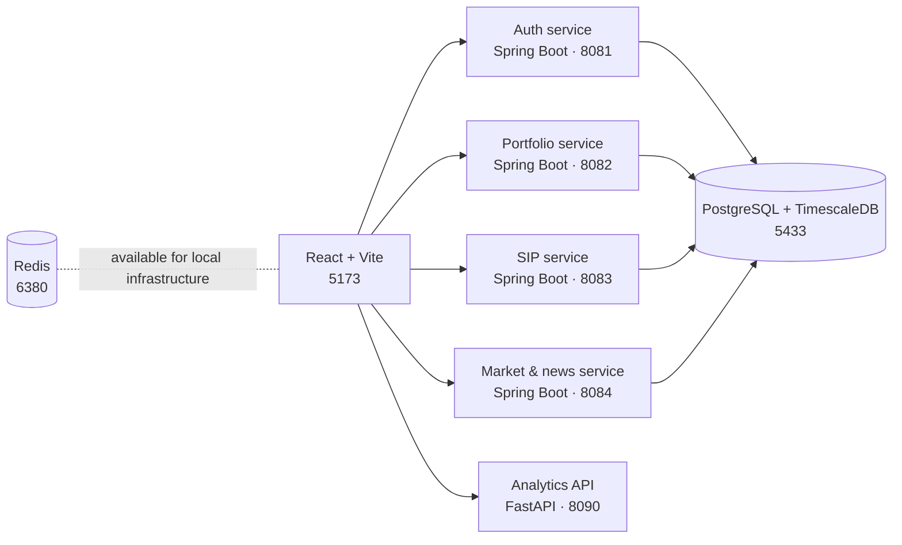

<p align="center">
  
</p>

<h1 align="center">LastStats</h1>

<p align="center"><strong>Track portfolios. Explore markets. Model what could happen next.</strong></p>

<p align="center">
  <a href="#features">Features</a> ·
  <a href="#architecture">Architecture</a> ·
  <a href="#quick-start">Quick start</a> ·
  <a href="#known-limitations">Known limitations</a>
</p>

<p align="center">
  
  
  
  
  
</p>

LastStats is an investment portfolio and market dashboard built as a full-stack learning project. It brings portfolio and SIP tracking, market data, archived financial news, and portfolio simulations into one web app. Market quotes and news depend on their upstream data providers and may be delayed or unavailable.

> **Project status:** The core application is implemented. The frontend production build and market service package build have passed; full browser-flow and live deployment checks are still outstanding. This project is for educational use and is not financial advice.

## Contents

- [Features](#features)
- [Architecture](#architecture)
- [Technology](#technology)
- [Quick start](#quick-start)
- [Services and local ports](#services-and-local-ports)
- [Configuration](#configuration)
- [Known limitations](#known-limitations)
- [Project layout](#project-layout)

## Features

| Area | What it does |
| --- | --- |
| **Accounts** | Registration, sign-in, token refresh, profile management, and password flows. |
| **Portfolio** | Manage holdings and transactions, view portfolio history, and calculate per-holding XIRR. |
| **SIP planning** | Create systematic investment plans and explore future-value projections. |
| **Markets** | Browse indices, search instruments, view quotes, and explore a world map of exchanges. |
| **News** | Browse RSS-ingested financial news saved in a database archive, with refresh and pagination. |
| **Analytics** | Run Monte Carlo growth simulations and drawdown analysis with an underwater chart. |
| **AI assistant** | Optional chat experience powered by a configured Groq API key. |

The exchange map includes a broad exchange directory; live quote support varies by exchange and provider. The listed exchange names are reference information and do not imply that each exchange has live quote coverage.

## Architecture



## Technology

- **Frontend:** React 19, Vite, React Router, Tailwind CSS, Recharts
- **Backend:** Java 21, Spring Boot 3, Spring Security, Maven
- **Analytics:** Python, FastAPI, NumPy
- **Data and local infrastructure:** PostgreSQL with TimescaleDB, Redis, Docker Compose
- **Market inputs:** RSS feeds and third-party market-data providers

## Quick start

### Prerequisites

Install Docker Desktop, Java 21, Maven, Node.js with npm, and Python 3.11 or newer. Start Docker Desktop before launching the database containers.

### 1. Start the database and Redis

From the repository root:

```bash
docker compose up -d
```

On a new Docker volume, Compose initializes the database schema and included migrations. If you already have a database volume from an earlier checkout, apply the current SQL migrations before starting the services. The Windows convenience script `start-all.bat` applies the migrations and launches the stack, but for analytics use the isolated Python environment below to avoid installing packages globally.

### 2. Start the backend services

Open a terminal for each service and run:

```bash
cd backend/auth-service
mvn spring-boot:run
```

```bash
cd backend/portfolio-service
mvn spring-boot:run
```

```bash
cd backend/sip-service
mvn spring-boot:run
```

```bash
cd backend/market-data-service
mvn spring-boot:run
```

### 3. Start analytics

```bash
cd analytics
python -m venv .venv
```

Activate the environment, then install and start the API:

```powershell
# Windows PowerShell
.\.venv\Scripts\Activate.ps1
```

```bash
# macOS / Linux
source .venv/bin/activate
```

```bash
python -m pip install -r requirements.txt
python -m uvicorn app.main:app --reload --port 8090
```

### 4. Start the frontend

```bash
cd frontend
npm ci
npm run dev
```

Open **[http://localhost:5173](http://localhost:5173)**. The analytics API docs are available at [http://localhost:8090/docs](http://localhost:8090/docs) while that service is running.

## Services and local ports

| Service | Port | Local URL |
| --- | ---: | --- |
| Frontend | 5173 | `http://localhost:5173` |
| Authentication | 8081 | `http://localhost:8081` |
| Portfolio | 8082 | `http://localhost:8082` |
| SIP | 8083 | `http://localhost:8083` |
| Market and news | 8084 | `http://localhost:8084` |
| Analytics | 8090 | `http://localhost:8090` |
| PostgreSQL / TimescaleDB | 5433 | `localhost:5433` |
| Redis | 6380 | `localhost:6380` |

## Configuration

- The root `.env.example` documents the optional `TWELVEDATA_API_KEY` used for some non-Indian quote lookups. Copy it to `.env` and provide your own key if needed.
- The frontend accepts `VITE_AUTH_URL`, `VITE_API_URL`, `VITE_SIP_URL`, `VITE_MARKET_URL`, and `VITE_ANALYTICS_URL`; each defaults to the local service URL shown above.
- AI chat can use `VITE_GROQ_API_KEY` in the frontend environment. Vite variables are included in the browser bundle, so use this only for local development and never put a private production key in client-side configuration.
- Local Docker credentials are defined in `docker-compose.yml` for development. Change them before using any non-local deployment, and never commit personal credentials or API keys.

## Known limitations

- Market quote coverage, rate limits, and freshness depend on external providers; support is not uniform across all exchanges.
- RSS sources and network availability affect when new articles appear.
- Per-fund NAV history does not yet have a complete data-writing pipeline.
- Full end-to-end browser flow and deployed service health have not been verified.
- The repository has remaining lint issues outside the files covered by the latest focused checks.

## Project layout

```text
backend/
  auth-service/          Spring Boot identity and account API
  portfolio-service/     Holdings, transactions, and portfolio history API
  sip-service/           SIP plans and projections API
  market-data-service/   Market quotes, exchange directory, and news API
analytics/               FastAPI simulation and risk analysis API
frontend/                React web application
init.sql                 Base local database schema
migration_*.sql          Incremental database migrations
docker-compose.yml       Local PostgreSQL and Redis containers
render.yaml              Render deployment blueprint
```

---

<p align="center">Built by <strong>Riya Janday</strong> · <a href="frontend/README.md">Frontend guide</a></p>